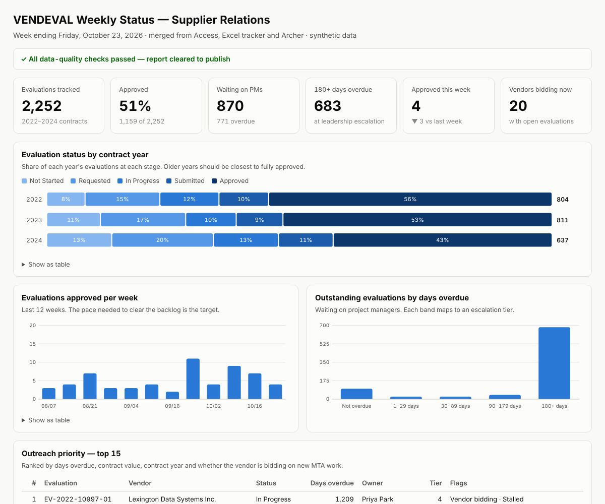
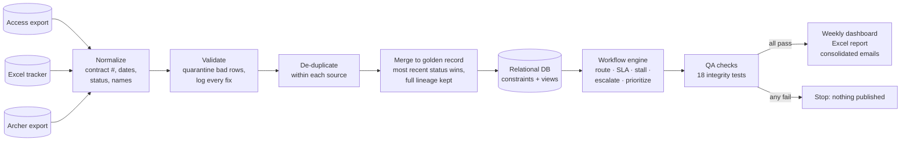

# Vendor Evaluation Tracking & Workflow Automation

An end-to-end pipeline for a procurement team's vendor-performance evaluation backlog.
It merges evaluation records that live in three systems (Microsoft Access, an Excel
tracker and Archer), cleans and de-duplicates them into one trusted dataset, routes every
open evaluation to the right person, detects delays, escalates overdue work, and produces
a weekly status dashboard - with an audit trail for every automated decision.

> **All data is synthetic** and generated by `src/generate_data.py`. It is modeled on how
> a public agency's vendor-evaluation process typically works; it is not real data and is
> not affiliated with or endorsed by any agency.



## The problem

Contract project managers are supposed to complete a performance evaluation for each
vendor after every contract period. Supplier Relations uses those evaluations to decide
whether a vendor is *responsible* enough to win future work. In practice:

- The same evaluation is tracked in **three systems that disagree** - different contract
  number formats, vendor-name spellings, status vocabularies and date formats.
- Nobody knows the **true backlog**, so outreach is manual and emails go one per evaluation.
- Evaluations get **stuck** with PMs who have left, and nothing escalates automatically.
- Leadership gets status numbers that **can't be traced** back to source records.

## What it does



| Stage | What happens |
|---|---|
| **Standardize** | Contract numbers (`C2022-10004`, `C 2022 10004` → `C-2022-10004`), 7 date formats incl. Excel serials, 20+ free-text statuses mapped to a 5-step lifecycle, "Last, First" ↔ "First Last" ↔ email matching |
| **Vendor matching** | 4-step match ladder: vendor ID → strict name key → loose key (with the contract's vendor as tie-breaker, so *Atlas Electric Inc.* and *Atlas Electric LLC* are never merged) → fuzzy match for typos that refuses to guess when two candidates are close |
| **Merge** | One golden record per contract period. Most recently updated status wins; ties broken by system precedence; every source row kept in a `lineage` table |
| **Routing** | Review status decides the lane (PM outreach vs. Supplier Relations approval queue). Inactive or missing PM → reassigned to the least-loaded active PM in the same department under a workload cap → else the supervisor |
| **SLA & escalation** | Due 30 days after period end. 4-tier ladder: PM (1+ days) → supervisor (30+) → department director (90+) → Supplier Relations leadership (180+). Stall detection per status (e.g. *Requested* with no movement for 14 days) |
| **Prioritization** | 0-100 score from days overdue, award value, contract year and whether the **vendor is bidding on new work right now** (its responsibility review can't be finished without these evaluations) |
| **Notifications** | Consolidated: one message per person per type per week, highest priority first |
| **Validation** | 18 checks: source-to-target reconciliation, uniqueness, referential integrity, rating ranges, lifecycle order, every overdue item notified, no work routed to inactive staff, workload cap respected. **If any check fails, nothing is published** |

## Results (report week ending Oct 23, 2026)

| Metric | Result |
|---|---|
| Source rows across 3 systems | **4,182** |
| Golden evaluation records | **2,252** (matches the answer key exactly) |
| Data issues found, fixed and logged | **1,574** (87 duplicates removed, 12 unusable rows quarantined, 322 cross-system status conflicts resolved, 20 out-of-range ratings caught) |
| Vendor names resolved to the right vendor ID | **100%** of 2,086 (scored against the synthetic answer key) |
| Status accuracy | **2,167 / 2,252** exact; the other 85 were out of date in *every* system - the pipeline picked the best available every time, and these are exactly the records PM outreach has to fix |
| Open evaluations routed with an owner | **1,093** (134 reassigned from inactive/missing PMs, 0 over workload cap) |
| Alerts consolidated | **1,968** per-evaluation alerts → **87** messages (≈96% fewer emails) |
| Integrity checks passing | **18 / 18** · unit tests **36 / 36** |

## Run it

```bash
pip install -r requirements.txt
python run_pipeline.py --regenerate      # build synthetic sources, run everything
python run_pipeline.py --as-of 2026-11-06  # re-run for another report week
python -m pytest -q                      # unit + end-to-end tests
```
Open `reports/weekly_dashboard.html`. Other outputs:
`reports/VENDEVAL_Weekly_Report.xlsx` (work queue with conditional formatting, workload,
notifications, vendor performance, data issues, QA), `reports/data_quality_report.md`,
`data/processed/vendeval.db` (SQLite: query with `sql/analysis_queries.sql`).

## Microsoft 365 implementation

The Python engine is the tested specification; production runs in Microsoft 365:

| Component | Guide |
|---|---|
| Access database (tables, validation rules, relationships, saved queries) | [`docs/access_build_guide.md`](docs/access_build_guide.md) |
| 4 Power Automate flows (intake/standardize, routing, weekly reminders & escalation, approval) | [`powerautomate/flow_specs.md`](powerautomate/flow_specs.md) |
| Power BI report (model, Power Query steps, DAX measures, pages) | [`powerbi/powerbi_build_guide.md`](powerbi/powerbi_build_guide.md) |

## Repository layout
```
src/
  config.py          business rules in one place (SLA days, tiers, workload cap)
  generate_data.py   synthetic Access / Excel / Archer exports + answer key
  standardize.py     normalize, validate, de-duplicate, merge, lineage
  workflow.py        routing, SLA, stall detection, escalation, priority, notifications
  database.py        loads SQLite with schema constraints + reporting views
  validate.py        18 data-quality and reporting-integrity checks
  report.py          HTML dashboard, Excel workbook, data-quality report
sql/                 schema.sql · views.sql · analysis_queries.sql
tests/               unit tests for every rule + end-to-end run
powerautomate/ powerbi/ docs/   Microsoft 365 build guides
```

## Design decisions

- **Most recent update wins, not "the system of record wins."** Access was a step behind another system on 163 evaluations; trusting it blindly would have under-reported 127 approved evaluations and sent reminders for work that was already done.
- **Never guess between two real vendors.** A wrong vendor match puts one company's poor rating on another company's responsibility file. Ambiguous names use the contract as evidence or go to manual review.
- **Validate before notify.** Emailing 60 project managers from a broken dataset destroys trust in the process faster than any delay.
- **Consolidate messages.** One weekly digest per person gets read; forty separate emails get filtered.
- **Rules live in config.** Changing the escalation threshold from 30 to 21 days is a one-line change (a SharePoint list item in production), not a rebuild.

## Limitations / next steps
Synthetic data only. A production rollout would need real field mappings from each system,
security trimming in SharePoint and Power BI (row-level security by department), retention
rules for evaluation documents, and a pilot with one department before scaling.
